# CoreFall · 临危受命

> 模块化塔防 × 俄罗斯方块式拼装：守住核心，建造、连接、研究，撑过每一波。
> *A modular tower-defense where you shape, link and research your defences — and keep the Core alive.*

《CoreFall（临危受命）》是一款用 Godot 4 制作的俯视角塔防 / 策略游戏。你在一个可自由走动的据点（Hub）里准备一切——研究蓝图、装备主动能力、升级补给、拼装连接模块——然后进入战场，用有限的模块在核心周围搭出防线。

**本仓库仅用于展示（Showcase）：不含完整源码、第三方美术与原始提交历史。**

[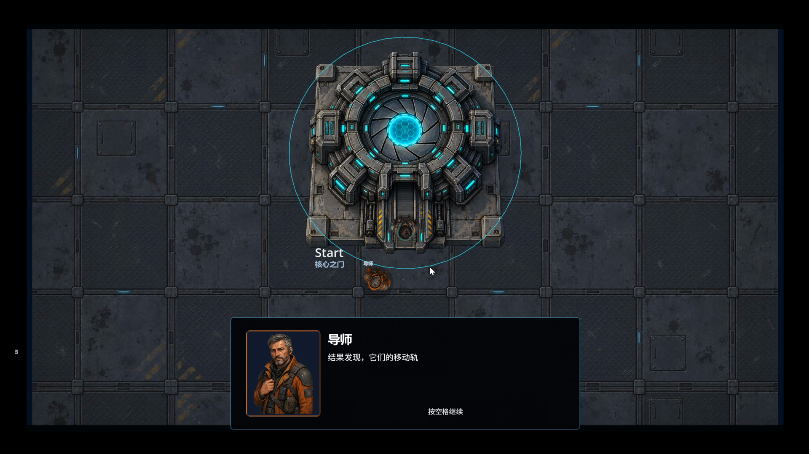](screenshots/01-hub-mentor.png)

| | |
|---|---|
| 引擎 | Godot 4.7（Mobile 渲染器） |
| 语言 | GDScript |
| 类型 | 塔防 / 策略 / 轻剧情 |
| 状态 | 开发中（含完整剧情关卡流程与无尽模式原型） |
| 界面语言 | 简体中文 / English |

## 玩法概览

- **可探索的据点 Hub**：WASD 走动，各设施就是菜单——导师、科学家、守夜电台值班员会在途中与你对话，剧情随关卡推进。
- **模块即资源**：战场上用“模块”建造火焰塔、冰霜塔、护盾塔、模块生产塔等；每波有模块上限，先想清楚再摆。
- **塔形与蓝图工坊**：塔由方块拼成，不同形状（T、十字、L、S……）决定射程与布局；在蓝图工坊用研究资源解锁新形状。
- **塔连接中枢**：在 10×10 的格子上拼装“连接模块”，相邻的模块会为对应的塔提供增益——摆放就是玩法。
- **行动中心：主动能力**：装备护盾、过载、单向跃迁门、惯性牵引等主动技能，战斗中按键释放。
- **补给站：永久升级**：提升初始模块、核心生命、每波模块上限。
- **敌人与蓝图档案馆**：每种敌人都有档案与背景记录，先了解再对付。
- **波次与失败反馈**：波次预告、小地图、1x/2x 加速、暂停菜单；核心被击破后可重新开始。
- **无尽模式**：通关后核心之门改为开启无尽模式。每 30 秒升一级，敌人数量、种类与强度随之增长；6 种塔可用（火焰、模块生产、冰霜、护盾、闪电、熵），还有熵地图。结算显示生存时间、等级、击杀与峰值敌人数。
- **大规模敌群优化**：空间哈希索引、分帧的堆式寻路流场、敌群 LOD 与渲染剔除，8 分钟模拟中约 565 个敌人时最坏单帧由 1130 ms 降到 ≤ 28 ms；录屏里同屏 260 敌人仍然流畅。
- **可访问性**：文字/UI 缩放、色觉模式、高对比度、减闪光、震动与动效强度、按键重映射；Dev Lab 可编辑敌人、塔、波次与数值。

## 截图

| | |
|---|---|
| [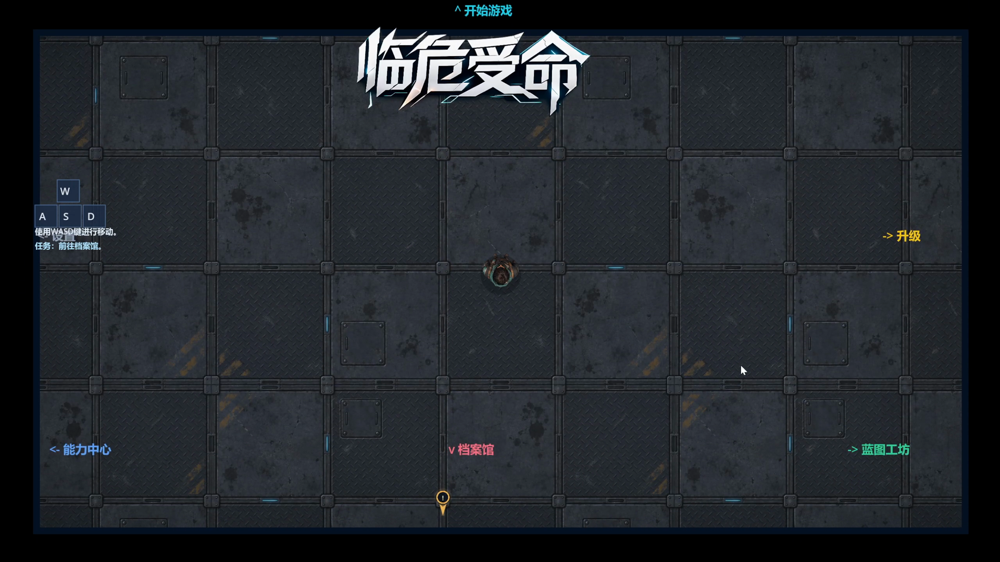](screenshots/02-hub-explore.png) 据点探索 | [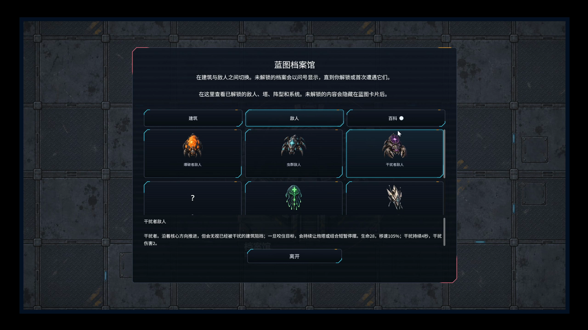](screenshots/03-enemy-archive.png) 敌人档案馆 |
| [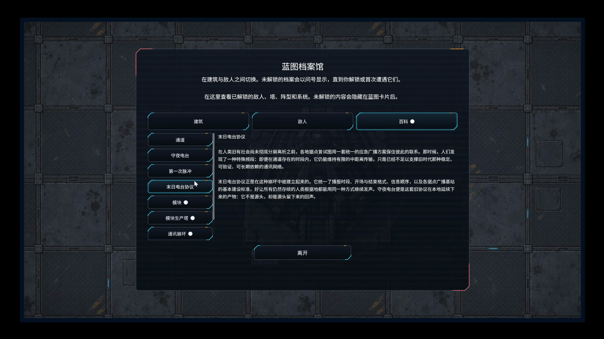](screenshots/04-archive-lore.png) 档案与背景记录 | [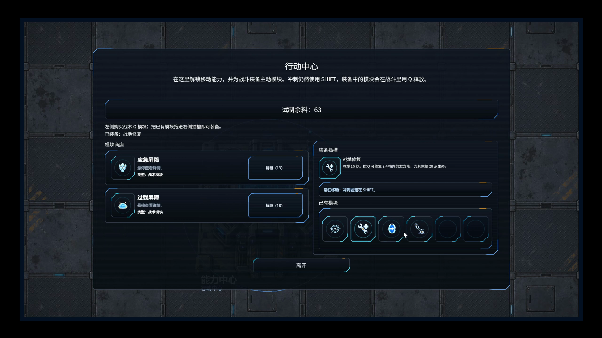](screenshots/05-ability-center.png) 行动中心 · 主动能力 |
| [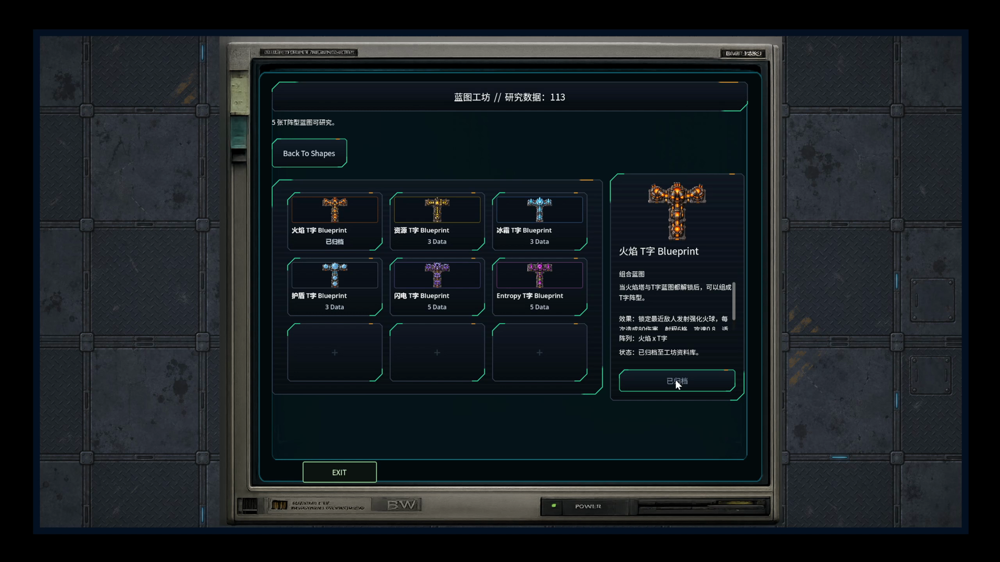](screenshots/06-blueprint-workshop.png) 蓝图工坊 | [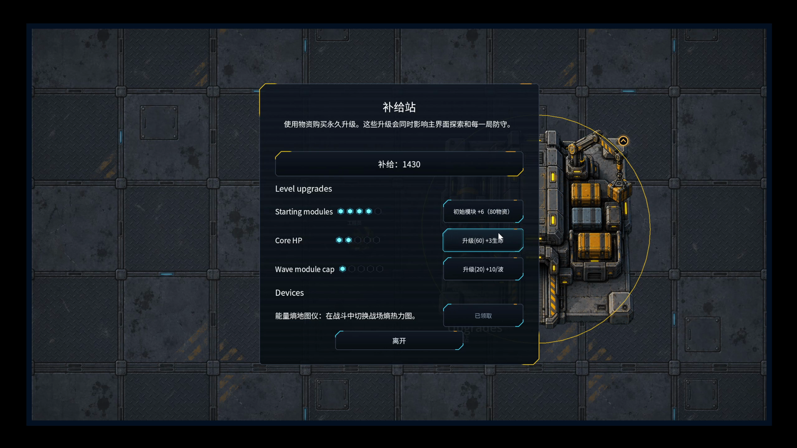](screenshots/07-supply-station.png) 补给站 |
| [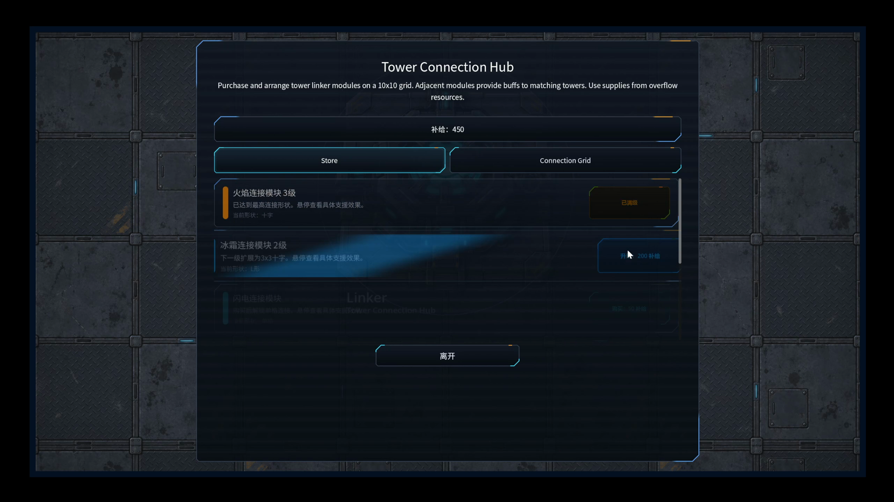](screenshots/08-linker-tutorial.png) 连接模块教程 | [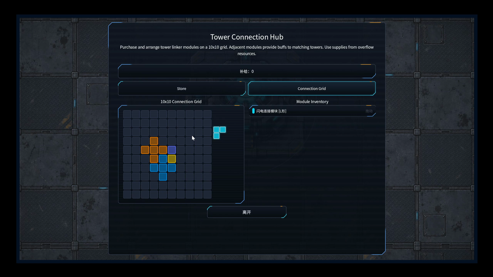](screenshots/09-tower-connection-hub.png) 塔连接中枢 |
| [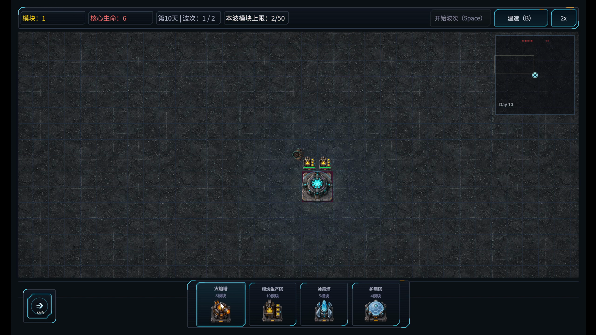](screenshots/10-story-build-phase.png) 剧情战斗 · 建造 | [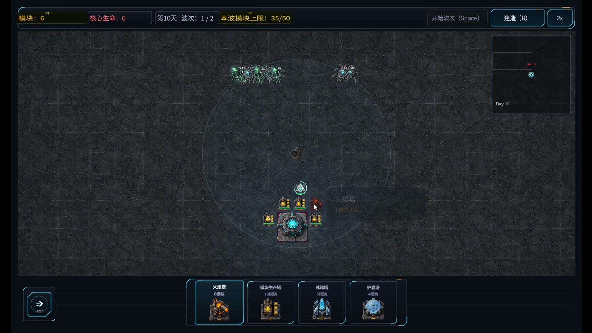](screenshots/11-story-wave-incoming.png) 剧情战斗 · 敌潮来袭 |
| [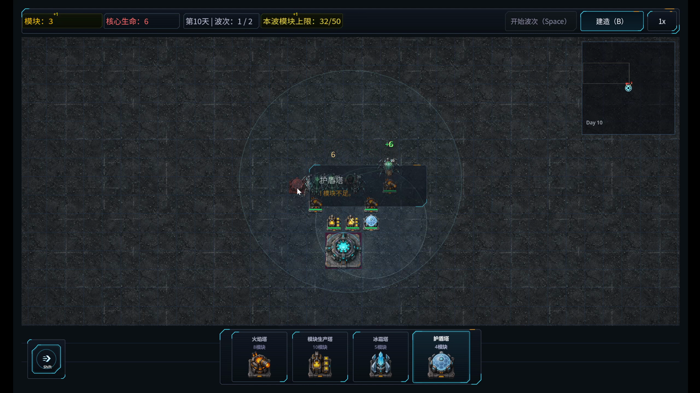](screenshots/12-story-shield-towers.png) 剧情战斗 · 护盾塔 | [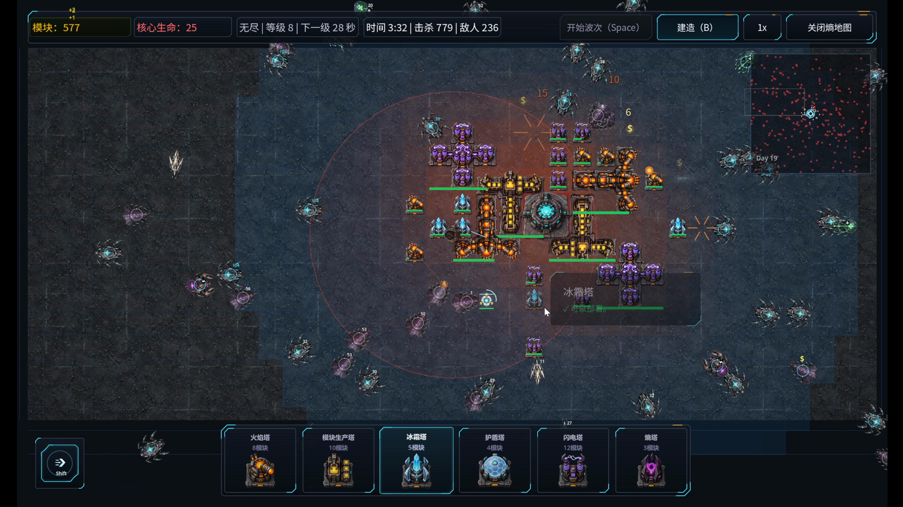](screenshots/13-endless-gate.png) 通关后核心之门开启无尽模式 |
| [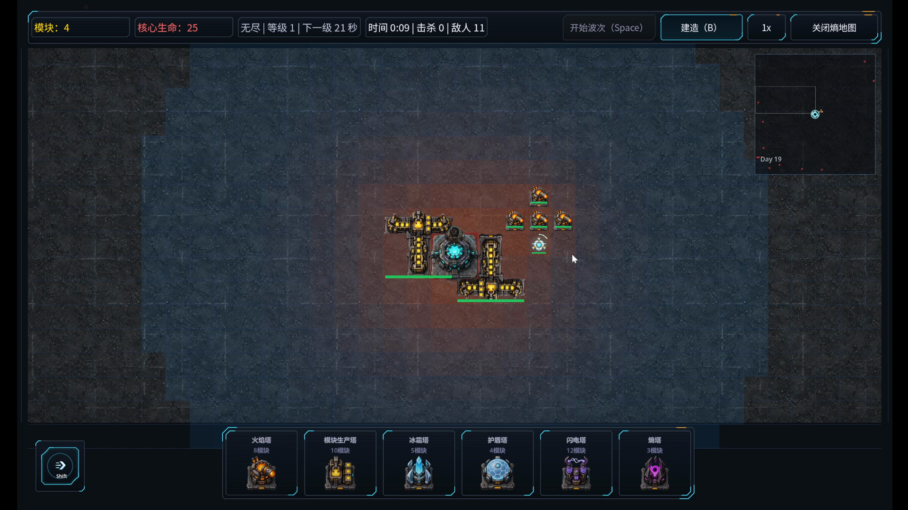](screenshots/14-endless-opening.png) 无尽模式 · 开局 | [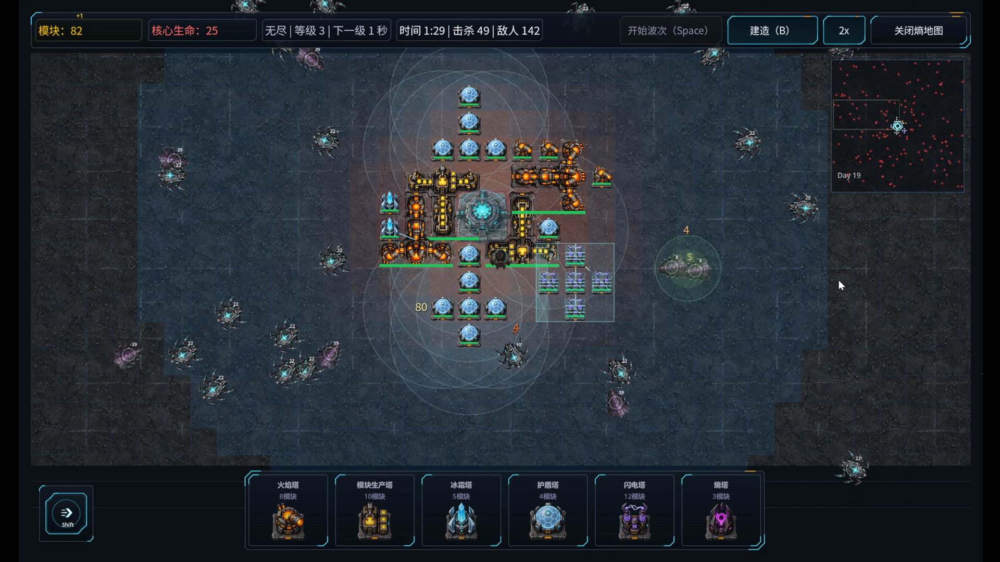](screenshots/15-endless-growing.png) 无尽模式 · 防线扩张 |
| [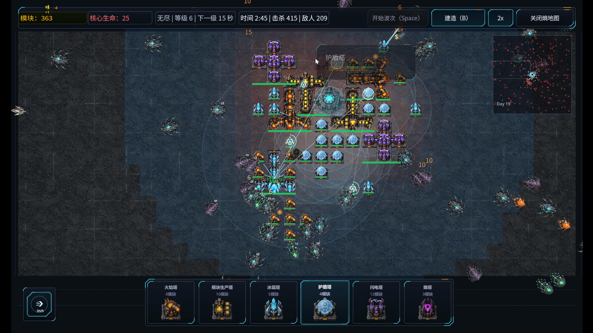](screenshots/16-endless-swarm.png) 无尽模式 · 敌潮 | [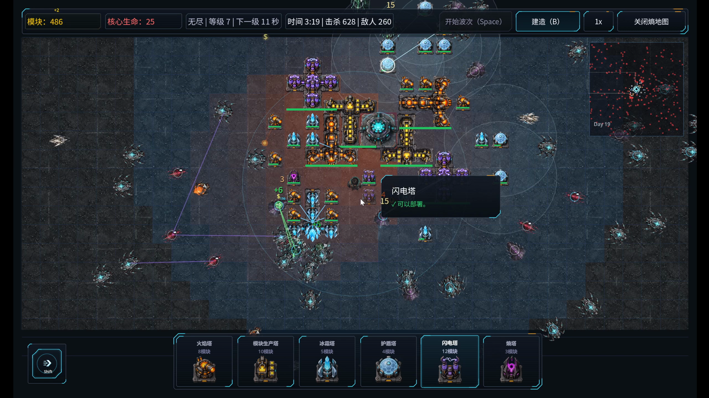](screenshots/17-endless-250-enemies.png) 无尽模式 · 同屏 260 敌人 |

## Demo 视频

> 上图为完整预告片的 GIF 版（2 分 57 秒，640p，8 fps，首次加载约 37 MB，请稍候）。1080p 带声音的版本：[`media/trailer.mp4`](media/trailer.mp4)。

预告片由 [`tools/make_trailer.py`](tools/make_trailer.py) 从两段原始录屏用 ffmpeg 自动剪出，调试片段已剔除。

## 文档

- [Architecture](docs/Architecture.md)：模块与数据流
- [Development](docs/Development.md)：开发过程与测试
- [Credits](docs/Credits.md)：第三方资源与版权

## English summary

**CoreFall** is a top-down modular tower defense built in Godot 4 (GDScript). Between battles you walk around a hub base: research tower shapes in the Blueprint Workshop, equip active abilities in the Ability Center, buy permanent upgrades at the Supply Station, and arrange linker modules on a 10×10 grid in the Tower Connection Hub so neighbouring modules buff your towers. In battle you spend a limited module budget around the Core to survive timed waves. The game ships in Chinese and English with a broad accessibility suite, a Dev Lab for tuning, and a post-story Endless Mode tuned to keep hundreds of enemies on screen smooth.

This repository is a showcase only — no full source, no third-party art, no original git history. The trailer in `media/` is cut from two raw gameplay recordings; the finale is the Endless Mode run with 200+ enemies on screen.

## 联系 / Contact

GitHub: [@lasersoldier](https://github.com/lasersoldier)
